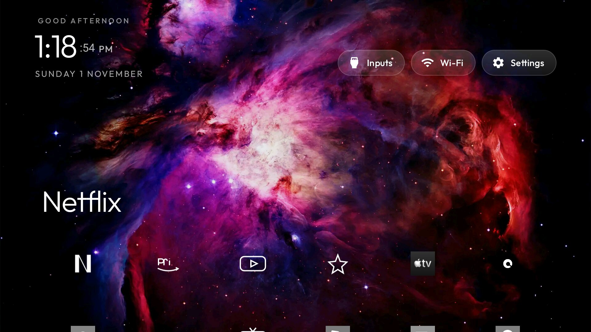
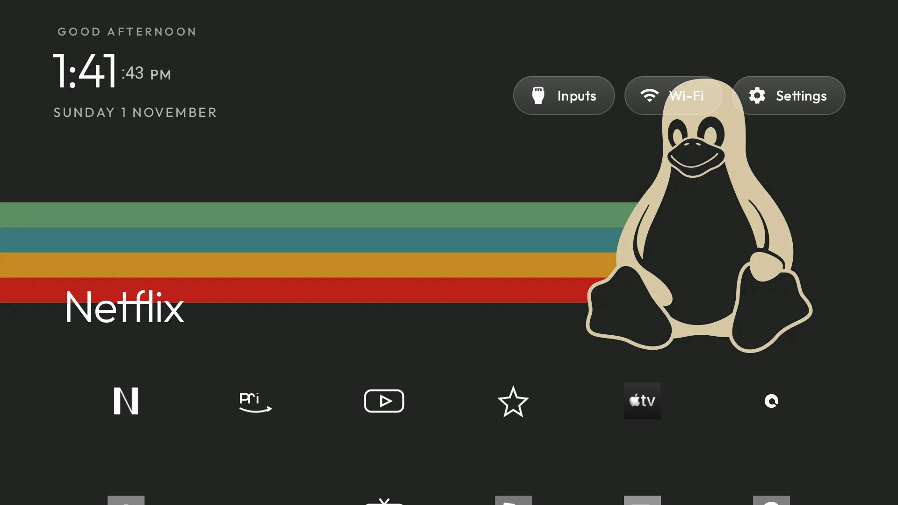
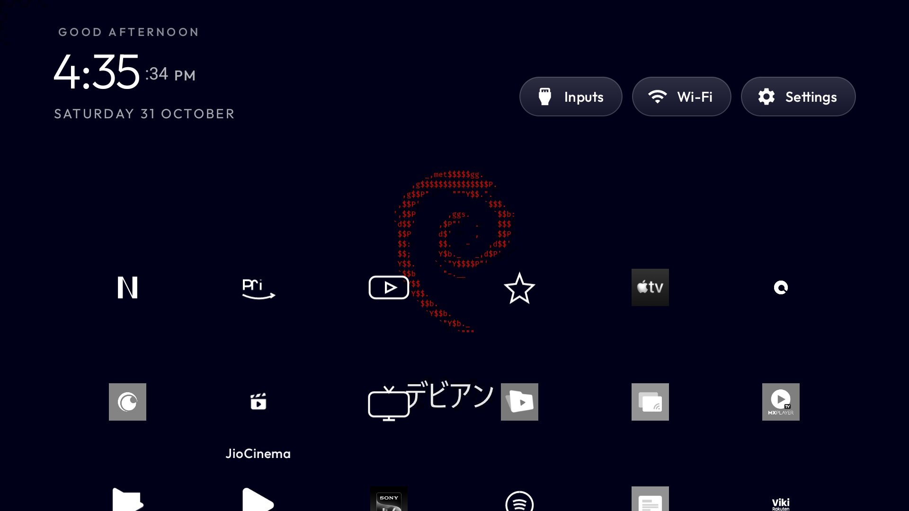

<p align="center">
  
</p>

# CleanYourTV — Custom Enhanced Edition

> **A blazing-fast, ad-free, Apple TV-style native launcher for Android TV & Google TV.**  
> Custom fork maintained by [@kdvajay](https://github.com/kdvajay), developed and verified on **Xiaomi Smart TV A 2024**.

---

## 📸 Live Screen Captures (Xiaomi Smart TV A 2024)

| Cosmic Wallpaper & Line-Art Dock | Cinematic Itachi Theme & Rolling Clock |
|---|---|
|  |
| *Borderless vector icons & rolling digital seconds ticker* | 

| Retro Pixel Art Theme | Smart Monochrome Icon Fallback |
|---|---|
|  |  |
| *Clean typography, time-aware greeting & date layout* | *Dynamic desaturation on squircle apps (Apple TV, JioCinema, Sony LIV)* |

---

## ✨ Key Enhancements in this Edition

### 1. Minimalist Borderless Line-Art App Banners
* **Pure Vector Icons**: Replaced heavy opaque cards with transparent, crisp white vector glyphs that blend seamlessly into any wallpaper.
* **Pre-bundled Services**: Native vector drawables for `Netflix`, `Prime Video`, `YouTube`, `JioHotstar`, `Spotify`, and `Live TV`.

### 2. Intelligent Dynamic Monochrome Fallback
* **No More Ugly White Squares**: Third-party TV apps with opaque or squircle icons (Apple TV, JioCinema, MX Player, Sony LIV, Zee5, Viki, Play Store) typically render with harsh white rectangular backgrounds on custom launchers.
* **4×4 Perimeter Sampling (`isSolidIcon`)**: Dynamically samples border pixels of arbitrary app drawables in [`AppAdapter.java`](launcher/app/src/main/java/com/gathin/tvhome/AppAdapter.java) to detect opaque backgrounds without hardcoded package lists.
* **`ColorMatrix` Desaturation**: Dynamically applies a luminance-preserving monochrome matrix filter to opaque icons, unifying all installed apps into an elegant monochrome look.

### 3. Animated Rolling Digital Seconds Clock
* **Live Rolling Ticker**: The seconds ticker (`:SS`) smoothly rolls upward with a 220ms ease-out vertical animation.
* **Millisecond-Synchronized**: Handler precisely aligns with `1000 - (System.currentTimeMillis() % 1000)` to eliminate jitter and maintain battery-efficient, exact-second transitions.
* **Full Header Info**: Preserves the time-aware greeting banner (`GOOD MORNING / AFTERNOON / EVENING`) and full formatted date below.

### 4. Smooth Spring Focus & Hover State Transitions
* **1.25x Spring Scaling**: Enabled `focus_overshoot` spring physics for natural, fluid enlargement when navigating apps with the TV remote.
* **Clean Card Styling**: Configured `glass_style: "none"` and `borderless_tiles: true` for an ultra-clean, floating dock and grid experience.

### 5. Extended 400+ Wallpaper Rotation Pool
* **Full Collection & Shuffle Support**: Extended [`WallpaperRotation`](launcher/app/src/main/java/com/gathin/tvhome/WallpaperRotation.java) to support 400+ 1080p WebP aesthetic wallpapers with seamless 1-minute random shuffle (`wallpaper_order: "shuffle"`).
* **Low Memory Footprint**: Hardware bitmap decoding keeps memory under 45 MB total PSS on 1 GB RAM TVs, rendering at 99.9% fluid 60 FPS frames.

### 6. Cold-Boot & Offline Resilience
* **Dynamic `Build.TIME` Clock Guard**: Fixes the common Android TV bug where TVs without a battery-backed RTC boot at the uninitialized kernel compilation timestamp (e.g. May 22). Keeps the clock cleanly hidden until Wi-Fi / NTP network time arrives, with a 60-second offline fallback.
* **Storage Mount Auto-Recovery**: Detects delayed `/sdcard` emulated storage mounting during cold boot in [`WallpaperPlayer.java`](launcher/app/src/main/java/com/gathin/tvhome/WallpaperPlayer.java), automatically loading wallpapers the moment storage mounts without needing an app restart.

---

## ⚡ Performance & Telemetry (Live TV Audit)

Measured directly on **Xiaomi Smart TV A 2024** (`192.168.1.2`, Google TV):

| Metric | Target | Measured Result | Status |
|---|---|---|---|
| **APK File Size** | `<= 589,824 B` (576 KB) | **`589,670 B`** | ✅ Passed |
| **Frame Latency (50th percentile)** | `< 16.6 ms` (60 FPS) | **`5.0 ms`** | ✅ Fluid 60 FPS |
| **Janky Frames** | `< 1.0%` | **`0.09%`** (99.91% smooth) | ✅ Ultra Smooth |
| **Total Memory (PSS)** | `< 80 MB` | **`44.9 MB`** | ✅ Ample Headroom |
| **Dalvik Heap** | `< 10 MB` | **`2.9 MB`** | ✅ Lean Runtime |

---

## 🚀 Quick Start Guide

### 1. Enable Debugging on TV
1. Go to **Settings** → **Device Preferences** → **About**.
2. Press **OK** on **Build** 7 times to enable Developer options.
3. In **Developer options**, turn on **USB debugging** (and Network/ADB debugging if available).

### 2. Connect via Wi-Fi ADB
```bash
adb connect <TV_IP_ADDRESS>:5555
```

### 3. Build & Install the Launcher
```bash
export TV_HOST=<TV_IP_ADDRESS>
launcher/build-and-install.sh
```

### 4. Push Wallpapers & Theme
```bash
# Push custom theme and wallpapers
TV_HOST=<TV_IP_ADDRESS> tools/theme.sh themes/<theme_folder>

# Reset to default launcher look
TV_HOST=<TV_IP_ADDRESS> tools/theme.sh --reset
```

### 5. One-Line Restore (Undo Everything)
```bash
TV_HOST=<TV_IP_ADDRESS> tools/restore.sh
```

---

## 🛠️ Project Structure

```text
cleanyourtv/
├── launcher/app/src/main/java/com/gathin/tvhome/
│   ├── MainActivity.java         # Clock synchronization, lifecycle & TV navigation
│   ├── WallpaperPlayer.java      # Hardware wallpaper playback & cold-boot auto-recovery
│   ├── WallpaperRotation.java    # 400+ wallpaper rotation & shuffle management
│   ├── AppAdapter.java           # Line-art icons & smart monochrome fallback
│   ├── GlassView.java            # Borderless & focus spring highlight rendering
│   └── Config.java               # Theme configuration & overlay parsing
├── launcher/app/src/main/res/
│   ├── drawable/                 # Vector banner assets (Netflix, Prime, YouTube, etc.)
│   └── layout/                   # Rolling seconds clock layout & activity_main
├── docs/screenshots/             # Live TV capture gallery
└── tools/                        # Python ADB communication & management utilities
```

---

## 📜 License & Credits

* **License**: MIT License ([`LICENSE`](LICENSE)).
* **Typeface**: [Outfit](https://fonts.google.com/specimen/Outfit) under SIL Open Font License.
* **Upstream**: Based on the open-source project by [Gathin23](https://github.com/Gathin23/cleanyourtv).
